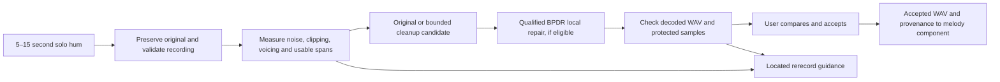

# BPDR: method to continue and January 2027 completion plan

Prepared 7 November 2026. Presentation month supplied by the owner: January 2027; exact date unknown. Plan to have the evaluated demonstration ready by 31 December. The owner explicitly confirms that free humming is essential and guide mode can be optional.

## Decision

Continue with a **hybrid vocal-input preparation component**, using existing audio validation and preservation machinery, a carefully evaluated cleanup path, and the BPDR pitch-repair experiment as a separate, bounded research workstream. Stop treating another Transformer architecture as the main route to completion.

The strongest immediate improvement candidate is **pretrained noise removal evaluated for the actual downstream melody extractor**, with original-audio fallback. It has promising existing engineering evidence, but the current gate is not qualified. Do not silently activate it. Keep the compact Transformer for the proposal's matched BPDR/augmentation-only/frame-only comparison. A simpler model may be used operationally if it wins the same delivered-audio evaluation; its model family is not the novelty.

This is a continuation recommendation, not a claim that the component is 90% complete or that the proposed route will pass. Cleanup cannot substitute for demonstrating the pitch-repair hypothesis. If usable pitch repair still fails the declared December decision point, report that limitation and agree any scope revision with the supervisors rather than count it as completed.

## 1. What was inspected and verified

The review covered the submitted 43-page proposal, master plan, tracker, continuation record, later short-phrase and restoration records, research notes, the owning training/runtime code, selected result artifacts, and the team handoff code. An inventory indexes 132 Markdown files across documentation, reports and research notes. Source, tests and tools contain 233, 130 and 224 files respectively, excluding bytecode. Filenames were inventoried throughout the workspace; every historical binary/run was not replayed. Reserved audio was not decoded.

New reproducible checks are saved in [the evidence audit](../results/transformer_usability/2026-11-07_continuation_audit/evidence_audit.json), generated by [audit_continuation_evidence.py](../tools/audit_continuation_evidence.py):

- Five important result files match their saved replay receipts: V56, V66, V71, the spectral-context comparison and V41. This confirms the current artifact bindings, not a fresh replay of their neural inference.
- Both real-noise studies' aggregate scores and singer-bootstrap lower bounds reproduce from all 567 stored rows per study, to floating-point precision. Each study represents 189 audio cases evaluated with three estimators, not 567 independent recordings.
- A [fixed subset replay](../results/transformer_usability/2026-11-07_continuation_audit/noise_subset_replay.json) independently recalculates 18 raw/neural pitch estimates: one training recording, clean and rain at 10/0 dB, with pYIN, PESTO and Praat. All archived RPA50 values reproduce exactly under the historical nearest-frame rule that selects the later timestamp on an exact tie. Choosing the earlier tied frame changes some scores by up to 0.4315 percentage points; pin this convention. This is three cases from one person, not the full study or new generalization evidence.
- All 189 saved neural-enhancement files have matching sample rates, frame counts and channel counts and contain finite samples. Seven FLOAT WAVs exceed absolute amplitude 1.0. This is headroom risk at integer-PCM export, not proof those floating-point files are already clipped. Equal lengths do not prove delay alignment.
- The unfinished objective comparison has six intact fit receipts: four augmentation-only and two frame-only. There is no final 12-fit result or final replay receipt. The saved augmentation-only outcome is essentially the zero-command baseline. No full BPDR outcome may be inferred from it.
- Fifty existing checks passed across foundation, preprocessing, objective, review, noise-preview and endpoint-permission suites. These verify engineering behavior, not natural-user effectiveness. No browser or listening qualification was performed.

The current selected tree preview is **ExtraTrees**, as recorded in the active pointer/export card. An XGBoost success was not established in the inspected authoritative artifacts. ExtraTrees' historical pilot improved 2 of 4 scoreable shifts from 16 attempts; 12 attempts were unscoreable and generalization criteria failed. It is useful evidence for a scoped example, not a proven general winner.

## 2. What the accumulated experiments say

| Investigation | Evidence | What it means |
|---|---|---|
| Architecture changes on held voices | Transformer reference 23/200 verified repairs; GRU 18, TCN 19, matched ExtraTrees 20 | Switching architecture alone did not solve that benchmark; this does not establish a universal Transformer winner |
| Short-note model comparison, V41 | Short Transformer raw error 24.147 cents; matched ExtraTrees 24.670; both fail raw gates | The small-data tree is not an already-qualified short-hum solution either |
| Larger physical short-note pool | 445 scoreable interventions from 1,152 attempts; 53 original windows | More usable training examples, but 707 construction exclusions; windows and augmentations do not create independent singers |
| V71 original-coverage candidate | 22/445 beneficial, 89/445 harmful; 8/53 originals changed; before/after singer-macro target error 24.897/24.226 cents | Small target improvement coexists with unacceptable unwanted edits; candidate remains inactive |
| Matched spectral context | 20.682-cent raw error with spectra versus 20.626 without; both fail gates | Adding the spectral input already tried is not the missing fix |
| Exact-original reference experiments | Reported strong improvement when the unshifted original supplies the answer | Oracle feasibility evidence; no deployment claim. The large oracle studies were not independently replayed in this review |
| Realistic nearest-semitone reference | Prior report flags about 33% of natural spans | A scale grid is not a reliable replacement for the user's intention |
| Existing downstream pitch-repair test | 82.6% to 93.8% label agreement, using oracle repair and the extractor's own original labels | Neither independently annotated note F1 nor deployable free-hum improvement |
| Neural noise removal, 0 dB mixtures | pYIN RPA50 59.80% to 79.92%; Praat 68.43% to 93.23%; PESTO 82.88% to 86.42% | A concrete cleanup hypothesis; these are frame-pitch scores on reused singing data, not note accuracy or humming success |
| Same neural noise gate | PESTO harms 18/84 cases, or 18/74 accepted cases; one harmful accepted clean control | The original all-tracker qualification fails. Do not rename the same result a pass because two trackers improve |

The noise study uses 21 Vocadito recordings, 14 singer groups and four recorded noise clips mixed digitally. It is more informative than synthetic tones, but it is not a study of naturally noisy novice phone hums. Repeated experiments on these sources are development evidence. The measured clean-input score is a baseline, not a mathematical ceiling; the logged fraction of loss recovered can exceed 100% when processing also helps the clean-track estimator.

See [Model_Family_Comparison_2026-10-30.md](Model_Family_Comparison_2026-10-30.md), [HumTrans_Transfer_Result_2026-11-02.md](HumTrans_Transfer_Result_2026-11-02.md), [Short_Phrase_Model_Result_2026-11-02.md](Short_Phrase_Model_Result_2026-11-02.md), and [Usable_Input_Plan_Status_2026-11-05.md](Usable_Input_Plan_Status_2026-11-05.md) for the retained historical denominators and qualifications.

## 3. Why more Transformer training has not resolved this

**The correction target is sometimes ambiguous.** A 20-cent movement may be an error, vibrato, a slide, tuning style or the intended new melody. More detailed measurements can estimate what was sung; they do not uniquely specify what should have been sung. A learned musical prior can infer plausible targets, but it is fallible. It would be incorrect to conclude that all reference-free correction is impossible or that every published corrector requires an external target.

**The target labels and deployment distribution differ.** Digitally modified accepted audio provides a known compensating shift. Free novice humming usually lacks that ground truth. HumTrans guide MIDI is not a manually verified performed-pitch curve. The proposed participant/reference work is still needed. Increasing the number of interventions from the same people does not fix this mismatch.

**Preservation and useful response compete.** The latest models can issue local false edits even on fitted sources. Mean original correction near zero hides damaging local peaks. Conversely, the newest augmentation-only arm collapses toward no correction. A near-zero loss component, stable boundary response or unchanged original is insufficient without useful positive-case response. Inspect class/view weighting, activation gradients and positive-versus-zero fitting before interpreting a collapsed control as a finished scientific comparison.

**Physical rendering matters.** Resynthesis with zero requested shift can still change features. The recorded eight-case control included one large change in the frozen model's requests. Short edits can extend beyond their target or hit a sample-free endpoint. Those are data/measurement/controller problems; adding attention layers cannot fix an impossible sample index or a mislabeled rendered example.

**The existing documents mix stages.** Completed data construction, raw prediction improvements, audited WAV repair, user review and research validation are different achievements. Several “active” job statements are stale. The records above, not the number of experiment folders, should drive the next decision.

These findings support an information, supervision, localization and delivery diagnosis. They do not prove that model capacity never matters.

## 4. The component to build

The original remains an available candidate throughout. Accepting a usable original is a valid result; it is not counted as a successful repair.

### A. Input validation and recording assistance

Reuse the existing decoding, anti-cancellation mono handling, resampling and handoff contracts. Surface measured problems with time ranges: clipped regions, too little usable vocal evidence, excessively low level, or an unreliable noise-only reference. Provide recording instructions, not musical note instructions. Keep duration, rest positions and the source-time mapping intact.

Add a technical comparison of multiple takes only after the primary path works. Let the user choose; do not assert that the cleaner take is closer to an unknown intended melody.

### B. Cleanup with an explicit fallback

Start with three candidates: format-only original, the existing conservative spectral path, and one frozen DeepFilterNet3 configuration in its isolated environment. Do not add declipping, dereverberation, source separation and a new generative restorer to the same experiment. Heavily clipped or overlapping-voice inputs receive rerecord guidance for the January scope.

The local spectral experiment estimates a noise profile from low-energy statistics; the proposal's conservative path requires a reliable voice-free region. These are different policies. Evaluate and document them separately. Do not quietly present the more aggressive experiment as the existing proposal implementation.

Freeze the actual downstream extractor and preprocessing. The current shared PP1 Vishwa adapter uses `melody_understanding.analyze_vocal` with its pYIN note stream. The standalone BPDR review workflow also has a separate GAME connection. Gains for one do not establish gains for the other. Benchmark the agreed January integration target first and retain another analyzer as an independent diagnostic.

At runtime there is no clean reference. A gate can inspect input/output acoustics, clipping, voicing continuity, conservative pitch agreement and model uncertainty; these are proxies, not a measurement of true note-F1 improvement. Offline, score the accepted output against independent references. Never allow clean-reference scores to choose a deployment candidate.

Begin with a simple fixed gate. If data support learning a selector, compare a regularized linear model and a small ExtraTrees or XGBoost classifier on candidate-level features, using measured harmful/beneficial outcomes as training labels. The new task is whether a candidate is safe/useful, not guessing an absolute intended melody. Split by singer, original recording, noise source and session before making variants. Do not train a selector on current test scores and call that independent validation. Keep “no change” as an explicit option, and report useful coverage so rejecting everything cannot win.

### C. Retain the BPDR research objective

Keep the core comparison from the proposal:

1. Original audio and the declared conservative rule baseline.
2. Augmentation-only Transformer: identical four-view data and supervised anchors.
3. Matched frame-only Transformer: boundary metadata removed.
4. Full BPDR Transformer: the additional boundary-invariance and counter-detuning response losses.

Hold data, splits, capacity, budget, model selection, cleanup, renderer and permission policy fixed across the three trained arms. Only full BPDR receives the extra response terms. Actual false splits, missing boundaries/merges and timing jitter must change the boundary-aware inputs while keeping A/B audio identical. The latest queued study establishes a shifted-boundary view; audit split/merge coverage before describing it as the entire proposal experiment. Frame-only equality is a construction property, not learned disentanglement.

Do not introduce a guide/reference into the main reference-free comparison. An optional guided/user-target mode is a separate extension with its own input contract and evaluation. Feeding downstream notes back as “truth” can create a circular pipeline and duplicates the notes owner's responsibility; it needs an explicit joint design, not an implicit shortcut.

For a justified new dataset, require originals, real physical detunes, identity-resynthesis controls, expressive no-change controls and known-zero context. Use a renderer or recording condition held out from fitting when possible to test whether the model learned rendering artifacts. These additions test a specific confound found in the workspace; they are not another architecture sweep.

Before paying for full training, require a small training-only fit diagnostic that demonstrates positive signed response and preservation, with loss terms and gradients logged separately. Reuse the existing unfinished head diagnostic if it answers this question. A diagnostic on training samples is not generalization evidence. Do not weaken the existing qualification gates to rescue a failed candidate.

### D. Delivered audio, review and handoff

Verify the final encoded/decoded WAV, including sample count/rate, finite data, peak headroom, delay compensation, changed intervals, protected samples and realized pitch change. A successful in-memory candidate is insufficient. For local pitch edits, compare samples outside the complete authorized support including crossfades. For whole-clip denoising, report preservation using acoustic/listening measures; whole-clip denoising cannot promise unchanged outside-edit samples.

If the user accepts several local edits, audit their final combination. On rejection or failed audit, retain the last usable version. Keep only the existing public statuses: `ACCEPT_UNCHANGED`, `ACCEPT_PREPARED`, `RERECORD_REQUIRED`, `TECHNICAL_FAILURE`; rejected statuses must have no accepted-audio path.

The current shared BPDR worker explicitly forwards accepted unchanged audio while exposing a repair preview separately. Therefore, showing a preview does not yet demonstrate that the harmonization pipeline consumed the improved waveform. A January acceptance check must hash-match the user-selected prepared WAV to the actual next-component input.

## 5. Preserve novelty and respect other components

The proposal's contribution remains: **test whether boundary-invariance and local counter-detuning objectives, with preservation anchors, improve bounded repair under segmentation errors compared with matched simpler controls, without increasing harm at matched coverage.** It is a hypothesis until evidence supports it. A negative comparison still completes an experiment; it does not establish the claimed advantage.

The current BERT-APC paper explicitly tests random boundary displacements. Table VIII reports declining target-note accuracy as displacement grows; it does not establish robustness to changing the number of segments through false splits/merges. This supports the narrower research question, not a claim that BERT-APC ignored boundaries. It uses learned musical context and substantial singing data, which distinguishes it from a small local acoustic correction experiment. [BERT-APC, v3, Table VIII](https://arxiv.org/html/2511.20006v3).

Other primary sources help delimit the contribution:

| Source | Relevant finding and implication |
|---|---|
| [Deep Autotuner](https://arxiv.org/abs/2002.05511) | Predicts continuous corrections from vocal/accompaniment relationships. Continuous correction and expressive preservation are established ideas; accompaniment is unavailable in the core free-hum workflow |
| [Dynamic Pitch Warping](https://dafx.de/paper-archive/details/sWdlau7ZOhe1JxhbaCEpPg) | Retunes toward a specified scale while preserving ornamentation. A useful reference-assisted baseline, not proof of free-hum intention recovery |
| [Reference-Free Singing Pitch Correction, 2026 preprint](https://arxiv.org/html/2610.11524v1) | Uses a symbolic music encoder, separate edit-necessity/offset heads and tonal reranking. Detection plus correction is not a new general idea; importing this pipeline would overlap note/key ownership |
| [Vocadito](https://arxiv.org/abs/2110.05580) | Provides musician annotations but documents disagreement between note annotations; quantizing F0 is not a sufficient note reference |
| [HumTrans](https://arxiv.org/abs/2309.09623), [Dynamic HumTrans](https://arxiv.org/html/2410.05455v1) | Guided humming is useful domain material, but published follow-up work identifies onset/offset alignment problems. More guide MIDI does not supply reliable local correction labels automatically |
| [DeepFilterNet](https://arxiv.org/abs/2305.08227) | A pretrained speech-enhancement method. Singing/humming suitability must be measured locally; its speech results do not qualify this component |
| [Teaching Speech Enhancement Models to Sing, 2026](https://arxiv.org/html/2607.11630v1) | Supports testing domain adaptation instead of training a large enhancer from scratch. Its task is singing separation, so its gains cannot be imported as noise-removal or pitch-preservation results here |
| [ROSVOT](https://arxiv.org/html/2405.09940v2) | Robust transcription motivates testing whether an extractor already tolerates an impairment; better-looking audio is not automatically better transcription |

These sources do not establish worldwide novelty for an enhancement-selection gate. Treat cleanup/gating as engineering support unless a separate literature comparison and experiment justify an additional research claim. The old statement that every corrector needs an external reference is too broad and is superseded by this review.

| BPDR responsibility | Keep with the owning component |
|---|---|
| Recording validity, noise/level preparation, acoustic evidence | Final notes, note boundaries/durations, beat, tempo, key/mode and musical interpretation: melody understanding |
| Bounded relative waveform edits, preservation, rollback and review | Genre-conditioned harmonic planning: planner |
| Accepted WAV, seconds/sample mapping, diagnostics and hashes | Chord realization/extensions/refinement: refinement component |
| Offline use of frozen extractors to evaluate preparation | Production ownership or retraining of those extractors |

The generic repository `system.md` predates/includes a different component framing. For this work use the submitted proposal's responsibility table and current handoff code. Do not build a competing note/key subsystem inside BPDR.

## 6. A finite research and implementation plan

The executable next decision is specified in [the next-experiment protocol](Next_Experiment_Protocol_2026-11-07.md). It separates a cleanup replication/qualification experiment from the incomplete scientific comparison. No new test cohort is opened merely to diagnose old code.

| Period | Deliverable and exit condition |
|---|---|
| 7–13 November | Finish source/result audit, resolve the actual extractor/configuration, verify final WAV export, review the unfinished objective sampler/head behavior, and freeze experiment declarations. Start arrangements for the existing eight-adult feasibility pilot and two independent reviewers |
| 14–27 November | Complete the corrected cleanup benchmark on development sources; collect/annotate permitted pilot recordings; quantify usable short-note coverage, sham-render behavior and reference disagreement. Reserve fresh people/sessions/noises before any new tuning |
| 28 November–11 December | Run the single justified BPDR matched comparison and frozen cleanup qualification. Compare actual WAVs, not just commands. Stop architecture/loss searching at this decision point; retain a passing method or report the failed hypothesis |
| 12–20 December | Complete timeline guidance, original/prepared A/B playback, protected intervals, selective acceptance where qualified, undo, final-combination audit and accepted-WAV integration. Verify desktop/mobile/error states |
| 21–31 December | Run the locked evaluation and independent listening; measure latency on demonstration hardware; prepare reproducible before/after cases and the completion evidence table. Finish the presentation package by 31 December |
| January, before the exact presentation date | Rehearse and fix reproducibility/UI defects. Do not keep tuning on the final cohort; any necessary model change needs a new validation statement |

The eight-adult/six-phrase pilot in the proposal is a feasibility estimate, not enough evidence for a broad 90% reliability claim. Use it to estimate annotation disagreement, usable yield and singer-level uncertainty; then fix the final study size and split before collection/testing. Participants, ethics/consent and independent reviewers remain real dependencies that code cannot supply. Do not relabel historical development people as fresh.

## 7. What “90% component completion” should mean

Use the actual university rubric if available. Otherwise the following is a **proposed engineering checklist**, to agree before scoring. Current percentages are deliberately not invented. Award each item's points only when its acceptance evidence exists; break partial items into explicit subchecks instead of subjective estimates.

| Work package | Points | Required evidence |
|---|---:|---|
| Record/upload and supported-format handling | 10 | End-to-end recordings, invalid/silent input handling and original preservation |
| Located diagnostics and useful rerecord instructions | 10 | Known-problem spans and real-user comprehension check |
| Bounded cleanup | 15 | Frozen comparison showing practical benefit, acceptable harm and final-WAV integrity |
| BPDR scientific comparison | 15 | Replayed matched arms, meaningful boundary interventions, preserved negative results and uncertainty |
| Useful pitch-repair functionality | 15 | Qualified delivered local repairs on the declared target scope; a guide-mode substitution must be an explicitly revised requirement |
| Review, protection, rollback and final-combination checks | 10 | Correct no-edit behavior and tested accept/reject/undo paths |
| Accepted-only next-component handoff | 10 | Exact prepared-WAV hash consumed; rejected audio cannot be forwarded |
| Held evaluation and independent listening | 10 | All-attempt denominators, subgroup results, human references and recorded judgments |
| Reproducible demo and reporting | 5 | Frozen versions, rerunnable evidence and honest presentation labels |
| **Total** | **100** | A proposed progress measure, not model accuracy |

Intake, cleanup, pitch-repair functionality, preservation, handoff and evaluation are mandatory. Do not obtain “90%” by counting many small UI tasks while pitch repair remains unqualified. If that mandatory function cannot be delivered, the original full component is still incomplete; a revised scope needs explicit academic agreement. Research comparison completion and a positive research finding are separate fields.

## 8. What the panel should see

Prepare four fixed, disclosed demonstrations from the declared demonstration set:

1. **Repairable noisy hum:** original and actually delivered output at matched playback loudness; show the measured noise problem, preservation checks and fixed-extractor results where independent reference exists. Label digital noise mixtures as controlled examples.
2. **Qualified local pitch repair:** show input, requested correction, applied correction and decoded-output F0 separately. Show the permitted interval and unchanged/protected regions. Use a controlled case if necessary and say so; it is not evidence of arbitrary natural-error correction.
3. **Good expressive hum:** demonstrate preservation and an unchanged acceptance. An unnecessary visible change would be a defect.
4. **Unusable recording:** show located feedback and a rerecord request with no downstream accepted path.

Always show denominators and the rate of harmful changes beside improvements. Do not use the raw correction curve as an after-pitch chart. At least one demo must show an actual beneficial delivered waveform; success cannot consist entirely of refusal or unchanged outputs. Human perception of a tiny cents change may be weak, so use objective evidence and honest listening judgments rather than exaggerating the effect.

## 9. Immediate recommendation in one paragraph

Use the next week to qualify the existing promising cleanup path and diagnose the unfinished matched BPDR run, while beginning the real-recording/reviewer process. Build the January product around **measured input quality, minimal verified preparation, preservation and exact handoff**, and retain the Transformer only where the experiment justifies it. Do not spend the next two months repeating architectures, downloading large unlabeled datasets, or treating oracle-reference recovery as a solution for free humming. The missing evidence is reliable labels, unfamiliar users/conditions, useful delivered audio and preserved musical intent.
