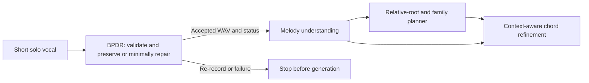

# BPDR master plan

**Current baseline: 12 October 2026. Owner: Liyanage L. N. P., IT23141506.** This is the authoritative scope and research plan. The [execution plan](PP1_Phase_Execution_Plan.md) gives tasks; the [evidence tracker](PP1_Evidence_Tracker.md) records actual results. Earlier versions are recoverable in `private/cleanup_2026-10-12/recovery.zip`.

## 1. Research purpose and system boundary

The project turns a short sung/hummed idea into genre-conditioned harmony while preserving musical identity:

BPDR owns audio integrity, assessment, conservative pitch repair, preservation, rollback and an auditable accepted-only package. Melody understanding owns notes, rests, rhythm, key, phrases and embeddings. Planning/refinement own harmony and genre conditioning. Component numbering varies across proposals; use names and owner IDs. Full source mapping and unresolved team contracts are in the [project audit](Project_Audit_2026-10-12.md).

The research question is whether boundary-invariance and local counter-detuning response losses, together with supervised preservation anchors, improve held-out small-detuning repair without damaging acceptable singing, relative to matched augmentation-only and frame-only controls. A Transformer, a separator or a successful pipeline run is not the contribution. A model that always predicts zero does not demonstrate successful repair.

Operating scope: one unaccompanied voice, WAV/FLAC, 0.25-20 seconds. Preserve the original, sample-time origin, internal rests, note order, tempo, expressive variation and duration. Do not infer intended notes by snapping to a scale, replace rhythm, synthesize gap-filling notes, repair heavily clipped recordings or treat multiple singers as supported. Jamendo separation is an offline data-preparation step, not a newly promised production input feature. Whistling appears in one figure but is outside the written singing/humming prototype scope unless separately validated. [S1 pp11,23-28]

## 2. Verified foundation and remaining work

| Area | Present evidence | Remaining gate |
|---|---|---|
| Technical audio path | Original retention, channel handling, resampling, frozen acoustics, checked export and failure paths | Musical suitability and repair permission remain unvalidated |
| Reference laboratory | 40 sources, 29 singers, 57 mapped crops; 114 pending review rows | Actual independent reviews and approved intervals |
| Interventions | Six audited shifts/18 variants of one phrase from one singer | Broader independent-source coverage; variants are not new performances |
| Learned implementation | Encoder, losses, loader, metrics, recorded engineering fits | Development selection, held-out study, no-change endpoint and uncertainty |
| Extractor compatibility | GAME pilot on 28 Vocadito recordings; accepted-audio check on 17 crops | Melody-owner agreement and repeat checks after real repair |
| Jamendo | 1,604 local tracks, three retained stems and limited screening | Common builder, representative sample, reviewed anchors and J3/J4 |
| Delivered repair | Not implemented | Controller, framewise renderer, remeasurement and rollback |

Use the current tracker for run IDs and regression results. Existing training metrics are measured on training pairs; they are not accuracy on independent data. No trained checkpoint currently establishes BPDR's research benefit.

## 3. Two datasets, two distinct sources of evidence

| Collection | Use now | Use after gates | Limits |
|---|---|---|---|
| Vocadito | Human F0/A1/A2 reference checks, controlled boundary cases, candidate review anchors | Reviewed multi-singer training/development and held-out reference evaluation | Small, with varying recording conditions; note labels do not identify an intended tune |
| MTG-Jamendo | Separated-vocal preparation and model-boundary engineering experiments | Supplementary preservation anchors after license, suitability, review and shift audits | Accompaniment, bleed/reverb/backing voices, no human F0/note reference or verified singer identity |

Both sources stay in this component. Jamendo extends the proposal; it does not replace Vocadito or the proposed participant study. Adult participant recordings, guide-melody cases and free humming remain a later ethics/consent-dependent study. The proposed 8 adults x 6 phrases is a planning estimate, not collected data or a justified final sample size. Determine main-study size from pilot precision/power. [S1 pp16-17]

Vocadito: split by singer before cropping/augmentation. Jamendo: split by source/artist before crops, cap initial sampling at one song per artist, check exact and near-duplicate audio, and retain every descendant in its parent's partition. Artists are proxies; recurring singers/collaborations can still cross artist groups. Keep evaluation/final-holdout sources untouched during geometry design and tuning. Any unfamiliar-melody claim also needs melody-level separation.

References must record `human_annotation` versus `model_estimate`. A GAME prediction or two agreeing trackers cannot count as two reviewers. An acceptable reference has target **zero correction**; a known audited local detuning has target **negative injected cents** on the validated plateau, zero outside support, with ramps excluded until validated. Neither GAME nor dataset MIDI notes are commands to overwrite the singer's pitch. Agreement checks assess reliability, not intended musical correctness.

Two musically experienced reviewers independently approve usable reference intervals, identify ambiguous transitions, and record reasons resolving disagreements. Both sources require that gate before research anchors. For Jamendo, additionally document whether model-estimated pitch is sufficient for the approved experimental role; do not manufacture human F0 files to satisfy the Vocadito loader. If changing the two-reviewer methodology, record and obtain supervisor agreement on the change before research claims. [S1 pp16-17]

Dataset terms: Vocadito is described by its [official record](https://zenodo.org/records/5578807). MTG-Jamendo's [official terms](https://github.com/MTG/mtg-jamendo-dataset#license) restrict the dataset to non-commercial research/academic use and provide individual audio licenses. Preserve attribution and license metadata; exclude NoDerivatives and unknown-license tracks from the transformation/release pilot. The local assessment counted 353 NoDerivatives tracks; verify licenses in each new manifest. Do not infer rights from the repository's code license.

## 4. Reuse models; own the preparation path

Retain the team's pinned BS-RoFormer separator and GAME commit/checkpoint, verified by hash. The newer melody/chord pipeline's vocal stage uses those same models. Its instrumental melody, combined melody, chords, key and Roman labels belong to other work and are not BPDR supervision. Its combined output fills vocal rests and resolves note overlaps; do not use it to evaluate vocal preservation. Read unshifted `model_midi_pitch`, retain stems, and save each decode because GAME has no exposed extraction seed.

The planned common builder produces immutable manifests with source/artist/singer identity as available, license, partition, crop origin, source/crop/accepted hashes, references and their type, model versions, decoded boundaries, reliability masks, review state and exclusions. For Vocadito: solo source -> mapped crop -> Phase 1 -> GAME boundary adapter, retaining human references. For Jamendo: licensed/grouped song -> kept stem -> mapped <=20-second crop -> Phase 1 -> GAME -> single-voice/pitch/bleed screening -> review queue. The existing Vocadito builder is reused behind a source-specific adapter; it cannot load Jamendo as-is.

Start with the three stems already present, then a declared training-artist sample of 20-30 normal songs. First run five artists and inspect yield before increasing volume. Use GPU separation and record model/platform/overlap settings. Do not mix settings silently. Full-song separation is the baseline; excerpt-first separation remains experimental until J5 is repeated across artists/windows. Do not process all 1,604 songs before yield and independent-source coverage are measured.

## 5. Repair quality is an acceptance gate

The proposal's runtime is a frozen acoustic analyzer, BPDR predictor and deterministic permission rules, followed by local rendering and remeasurement. Offline controls do not become additional production stages. [S1 pp23-27]

1. Assess technical integrity and musical suitability. Current Phase 1 proves the former only. Calibrate the latter on labelled suitable/unsuitable examples including silence, noise, leakage, multiple voices and acceptable expressive singing.
2. Predict relative cents corrections under the main and reasonable alternate boundary views. Require reliable voicing, sufficient support, bounded uncertainty and agreement; protect onsets/offsets, rests and expressivity. Corrections beyond allowed limits are withheld, not silently clipped.
3. Render only permitted intervals with a duration-preserving framewise method; the proposal names Praat/Parselmouth. The artificial constant-shift generator is not the production renderer. Pin the renderer and audit zero-change identity, realized pitch, transitions and changes outside edit support.
4. Remeasure delivered audio. Preserve sample count/time origin and rests; verify pitch error on supported regions, protected-region drift and audible artifacts. Compare the same frozen extractor before/after and against its repeat variation.
5. Roll back a failed candidate to a previously checked usable waveform; otherwise return a reasoned non-accepted status. Withheld edits may produce `ACCEPT_UNCHANGED` only if the input is suitable. Emit `ACCEPT_PREPARED` only after all applicable checks pass.

Freeze numerical bounds on training/development data before held-out testing. Report abstentions/edit coverage, failures and harmful edits with repair error; accepting everything or correcting nothing cannot alone demonstrate accuracy. Thresholds in current Phase 1 are provisional engineering settings, not calibrated musical guarantees.

## 6. Fair study and output assurance

Compare original input, a declared conservative rule baseline, augmentation-only, frame-only and BPDR. The three learned conditions share data, partitions, capacity as appropriate, source weighting, optimizer/update budgets and selection protocol. Fit normalization on training sources only. Use at least three predeclared seeds where feasible and label a one-seed run exploratory. Select checkpoints/weights/controller thresholds on development data; freeze before evaluation. Disable denoising in the initial comparison. If introduced later, all correction conditions share one fixed noise policy; the original control receives only necessary decoding/format conversion. Conditional denoising requires a reliable nonsinging noise interval, feature recomputation and preservation/rollback checks, with its effects recorded separately from pitch repair. [S1 pp17-22,26]

Keep three boundary conditions separate: controlled human-annotation tracks, the operating audio heuristic, and GAME model-estimated tracks. Training currently uses A1 timings while runtime uses a heuristic; quantify that distribution change rather than claiming synthetic invariance proves runtime robustness.

Evaluate jointly: plateau correction error, boundary-response sensitivity, preservation inside/outside support, dedicated no-change cases (vibrato, slides, acceptable transposition), rendered pitch/artifacts, harmful-edit rate, technical integrity, edit/acceptance coverage, latency and same-extractor note performance. Include onset+pitch and offset-aware results with their conventions. Show raw predictions and delivered/controller outcomes at comparable coverage. Pair comparisons by independent singer/source and give 95% intervals with denominators, exclusions and failures. Repeated frames/variants are not sample size. Blinded listening uses fixed playback conditions; a small listener sample is a pilot.

Use held-out Vocadito references for the first controlled pilot. Keep Jamendo robustness/yield results separate and do not score accuracy against the same pseudo-labels used to select examples. Participant data is needed for broader real-user or intended-melody claims. If no independently reviewed examples exist, continue useful engineering work but report no supervised comparative result.

## 7. Integration and schedule

The accepted package contains request/source IDs, status, WAV path/hash/rate/count/channels, time-origin/crop mapping, reason codes and links to versioned diagnostics, analyzer/model/controller/renderer policies and edit intervals. Consumer validation rejects missing/tampered audio and non-accepted statuses. Do not downsample or recrop without explicit mapping. The current `ProcessingResult` schema 0.1 is a proposed contract; the melody owner must accept the actual format. GAME is a fixed baseline adapter until that owner identifies the agreed extractor.

H1 currently supports technical format compatibility, not repair correctness or team acceptance. Extend H1 after actual `ACCEPT_PREPARED` output, and once on evaluation data with extractor repeat variation. For repaired audio, require preserved timing/rests and no unintended degradation outside permitted edits; inside edited support, measure pitch against the declared correction reference. Do not require repaired pitch to match the deliberately detuned input. Later isolate raw-vocal, prepared-vocal and reference-melody downstream paths under fixed planner/refiner settings to measure error propagation.

The previous user planning target is **25 October**. The supplied proposal's schedule figure lists an initial PP1 prototype on **26-28 October**; neither establishes the official slot here. The proposal places controls in Nov-Dec, BPDR study Dec-Jan, integrated evaluation around Feb 2027 and final submission around Apr 2027 (estimated). Do not promise the whole scientific study by October. The execution plan separates a near-term engineering prototype from the subsequent reviewed study.

## Sources

- S1: supplied IT23141506 proposal, all 43 PDF pages; scope pp11-17, comparisons/losses pp17-23, diagrams pp24-25, delivery pp26-28, schedule p36.
- S2: supplied IT23439078 proposal, all 57 pages; architecture p38, datasets pp29-30, accepted-only contracts pp53-55.
- S3: supplied IT23148086 proposal, all 37 pages; representation/scope pp19-24, upstream-error isolation p18.
- S4: supplied IT23157132 proposal, all 44 pages; data/context pp20-25, architecture p26, refinement mapping ambiguities pp10-11,23.
- Source copies remain in `private/proposals`; exact source hashes and full-page audit are recorded in [Project_Audit_2026-10-12.md](Project_Audit_2026-10-12.md). Historical rubric/work-package details remain in the recovery snapshot.
