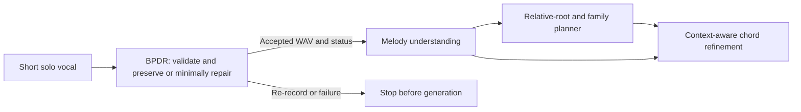

# BPDR master plan

**Latest completed step — Gate E human-reference development packaging, 16 October:** [actual development package](Gate_E_Human_Reference_Development_Packaging_2026-10-16.md). Nineteen usable variants; two unobservable merge variants refused (21 was the plan). Combined development catalog 304: 19 Vocadito + 285 unchanged Jamendo; all 88 no-change controls retained. 326 tests pass; training loaders refuse development data. No new audio, extraction, audit, model execution or fitting; research-ready examples zero. **Next:** Gate E frozen-model development evaluation: separately declare evaluation of the three historically selected model checkpoints (augmentation-only update 25, frame-only update 50, BPDR update 300), using their verified Windows CPU exports and the unchanged training-only normalizer. Compare each with zero correction on the explicit 304-pair development catalog (19 Vocadito / 285 Jamendo) and all 88 retained no-change originals. Report both datasets separately and recording/singer-or-artist-proxy-aware macros, direction/corruption coverage, preservation, boundary sensitivity and actual counter-detuning response. This is post-selection exploratory development diagnosis: no checkpoint reselection, fitting, gain/loss search, rendering or production adoption. Keep all audit and boundary refusals visible; reserve PP1/final holdouts. Human review remains deferred (D/J4), Gate E and F open, research-ready examples zero.

**Prior completed step — Gate C full development support audit, 16 October:** [complete fixed-support development audit](Gate_C_Development_Support_Audit_2026-10-16.md). All 28 keys retained: 7 pass, 17 measured failures, 4 unattempted geometry keys. Twenty new shifts; four pilot attempts reused. 313 tests pass. No new paired examples, fitting or pipeline changes; research-ready examples zero. **Next:** Gate E validation preparation, with Gate C eligibility safeguards retained: declare and package only the seven passing fixed-support shift cases into A/B/C/D development views (split, merge and jitter: 21 planned variants from six phrases / three recordings / three singers). Reuse saved waveforms, acoustics and private masks/targets; retain Gaussian boundary sigma 0.04 seconds and the existing 71-column contract. Keep all 17 measured failures and four unattempted geometry keys in the inventory; failed cases stay outside targets. Keep the existing training-only normalizer, singer partitions and all original no-change development controls. No new rendering, audit retries, support/threshold search or fit. Verify packaging and loader refusals before any separately declared frozen-model evaluation. These would remain exploratory development examples, not research-approved training data. Gate E open, D/J4 review deferred, F open.

**Prior completed step — Gate C acoustic pilot for Gate E, 16 October:** [fixed-support acoustic pilot](Gate_C_Support_Acoustic_Pilot_2026-10-16.md). Four measured shifts: two pass and two fail, with zero sources passing both directions. All failures retained; 306 tests pass. No new paired examples, optimizer updates or model adoption; common pipeline unchanged, research-ready examples zero. **Next:** Gate C prerequisite for Gate E: separately declare completion of the same -30/+30-cent audit on the remaining ten development phrases with locked multi-interior geometry. Reuse these four measured pilot attempts; do not rerun them or search alternate supports/renderers/thresholds. Keep the two geometry-refused development phrases, every failed direction and all 24 prospective shift outcomes visible. Audit completion must precede any paired-view packaging or model fit. Training candidates still require final acoustic masks; main comparison and diagnostic fits are unchanged. No musical approval, model adoption or repair-accuracy claim. Gate E open, D/J4 deferred and Gate F open.

**Prior completed step — Gate C support geometry for Gate E, 16 October:** [multi-interior geometry evidence](Gate_C_Multi_Interior_Geometry_2026-10-16.md). Development 12/14 final-mask geometry candidates (old selector 0/14); training 29/30 annotation-only candidates (old selector 3/30). No new acoustically audited pair or optimizer update; all refusals and original masks retained. 297 tests pass. Research-ready examples zero. **Next:** Gate C support/audit prerequisite for Gate E: declare a bounded acoustic pilot on the locked multi-interior supports before any generation. Use two development phrases from distinct recordings/singers, deterministically first by phrase ID (vocadito_2_p00 and vocadito_5_p00), with -30/+30-cent injections: four attempted shifts, no fallback support search. Reuse the existing renderer and independent YIN/PESTO audits with every threshold, original mask and refusal retained. Measure plateau coverage, actual shift error, outside drift and exact outside samples; geometry does not establish these. This is a support-protocol engineering pilot, not model validation or fitting. Training annotation candidates require their own final acoustic masks before interventions. No new training, loss/gain search or holdout access. D/J4 review deferred, Gate E and F open.

**Prior completed step - Gate E fixed feature weighting, 16 October:** [fixed feature-group ablation](Gate_E_Feature_Weighting_Control_2026-10-16.md). Control plateau error 17.90727 cents / 5/8 passing; treatment 29.99966 cents / 0/8. The fixed group-size treatment does not improve the combined recovery/preservation result over the saved control in this bounded test. It is not adopted. This tests this specific scaling and budget, not every possible use of pitch features. The saved control is authenticated and not retrained; 100 new treatment updates, 288 regression tests passing. No dataset, shared-pipeline or production policy change. Research-ready examples zero. **Next - Gate E validation prerequisite (Gate C support design): investigate reference-feasible support geometry on the frozen Vocadito training/development partitions before another fit. Start with a read-only geometric design: can one waveform intervention span several trusted note interiors while keeping existing trusted-frame masks, edge guards, minimum audited-frame counts and independent shift audits intact? Retain the existing continuous-support refusals and failed Jamendo crop; do not lower thresholds or relabel targets to fill coverage. Declare any new support protocol before generating audio/pairs; keep PP1/final holdouts reserved. D/J4 review deferred, F open. No further gain search is declared.**

**Prior completed step - Gate E input/response diagnosis, 16 October:** [measured inputs and saved-model response](Gate_E_Input_Response_Diagnosis_2026-10-16.md). The failed Jamendo crop contains both injected shift directions; missing pitch input does not explain its weak response. Post-hoc feature probes suggest spectral dependence and negligible response to the tested explicit-pitch replacement; this is not causal proof. All 312 inference vectors reload exactly, 281 tests pass, zero new optimizer updates. No crop rejection, target/mask change or loss/model adoption. Research-ready examples remain zero. **Next - Gate E: declare a two-arm BPDR-local feature-group weighting ablation, keeping the balanced loss, eight source/shift pairs, initialization, normalization and update budget matched. Compare existing standardized inputs with fixed group-size normalization (64 log-mel columns divided by sqrt(64)=8; scalar groups unchanged). Reuse the verified saved balanced-input control if its full protocol matches, rather than repeating its fit. This is a post-hoc hypothesis from the diagnosis, not a demonstrated fix. Declare before fitting, retain the failed crop and measure all recovery/preservation limits. No common-pipeline change or paired-original/target cue at runtime. Independent human-reference support feasibility remains separate; D/J4 deferred, F open.**

**Prior completed step - Gate E multi-source control, 16 October:** [recovery and preservation diagnosis](Gate_E_Multisource_Control_2026-10-16.md). Four frozen training sources, eight audited pairs, three declared losses / 300 additional diagnostic updates. No loss passes all eight provisional training-pair limits. This bounded test does not demonstrate preservation-safe recovery across the selected sources and directions. Inspect source/direction recovery and feature sensitivity before another fit; neither the region-balanced nor stronger-preservation loss is adopted. One-source learnability does not establish that a shared model can learn these multiple sources and both directions within this budget. Earlier 900-update comparison and 400-update single-source diagnostic remain unchanged. Research-ready examples remain zero. **Next - Gate E: diagnose source/direction failures and runtime-input sensitivity on the saved eight pairs without another fit. Quantify whether +/- injections remain distinguishable in the measured pitch/spectral inputs and inspect prediction residuals. Retain failing pairs; do not remove data solely because the model performs poorly. Separately design reference-feasible supports retaining trusted human interiors and explicit audits. No main comparison rerun until a new declaration is justified. D/J4 deferred; F open.**

**Prior completed step - Gate E learning control, 16 October:** [controlled learning and preservation diagnosis](Gate_E_Learning_Control_2026-10-16.md). Four fixed 100-update tests on one existing Vocadito training pair establish nonzero learning. Real-input existing-loss plateau error falls from 30 to 20.585 cents. Balanced regions reduce error to 12.435 cents but alter the original plateau by 13.190 cents; no loss or model is adopted. The original 900-update comparison and all frozen inputs remain unchanged. Research readiness stays zero; human-reference paired validation unresolved. **Next - Gate E: declare a bounded multi-source training diagnostic using the existing audited inputs, both shift directions and separate original-plateau, outside-region and repair measurements. Test preservation-aware region weighting before changing the corpus training loss. Separately design reference-feasible supports retaining trusted human-annotation interiors and explicit audits; do not remove guards to manufacture coverage. Repeat the main matched comparison only after these checks justify a new declaration. D/J4 deferred; F open.**

**Prior completed step - Gate E exploratory comparison, 16 October:** [development audit and matched models](Gate_E_Exploratory_Comparison_2026-10-16.md): 285 Jamendo development examples from 95 passing shifts / 24 crops / 12 artist proxies; all 528 declared keys retained. Three matched models execute 900 total updates; 36 checkpoints and raw metrics are verified. Vocadito paired development and the full two-dataset paired macro remain unavailable. Selected BPDR remains near zero and does not beat the zero-correction criterion; useful repair is not demonstrated. Separate preservation diagnostics cover 88 original candidates. Research-ready examples remain zero; no learned repair is delivered or adopted. **Next - Gate E repair-benefit validation remains open: diagnose the observed near-zero response with a small controlled overfit/gradient test, audit zero-target weighting and input pitch sensitivity, and design a human-reference-feasible follow-up. Declare each new ablation before changing masks, intervention rules, loss weighting, features or model settings. Preserve the current comparison, source partitions and reserved PP1/final holdouts. Gate D/J4 musical review is deferred; Gate F delivered repair remains open. This single-seed synthetic comparison does not authorize model adoption or shared-pipeline changes.**

**Prior completed step - Gate E preparation, 16 October:** [aligned inputs and locked protocol](Gate_E_Comparison_Preparation_2026-10-16.md): 936 engineering examples (18 Vocadito + 918 Jamendo), 3,744 verified views, common Gaussian boundary encoding, weighted train-only normalizer and a saved common sampling schedule. Original audio, targets, audits, partitions, reviews and shared pipeline remain unchanged. No learner fitting or development processing yet. **Next - Gate E remains open: prepare the declared development comparison with unchanged screen/audit rules and all failures retained, then run the three matched exploratory conditions using the locked schedule, training-only normalizer, per-example loss reduction and memory-safe evaluation. Select checkpoints only by the declared development metric; if development pairs are unavailable, report selection unavailable. Keep PP1 evaluation and final holdout reserved. Gate D/J4 review stays deferred; Gate F delivered repair stays open.**

**Prior completed step - Gate C engineering pairs, 16 October:** [controlled pair audit](Gate_C_Shared_Pairs_2026-10-16.md): 71 crops / 23 artist proxies, all 426 shift requests, 306 passing shifts, 918 four-view engineering examples across 23 artist proxies. Research-ready examples and learner updates remain zero. Source masks, policy, partitions, reviews and common pipeline are unchanged. **Next — Gate E engineering: align timing-only boundary encoding across Vocadito/Jamendo in new derived inputs while preserving historical pairs, then lock the matched BPDR, augmentation-only and frame-only comparison protocol (same frozen training sources, audited targets, normalization, model budget and seeds) and the development preparation/evaluation rule before development tuning. Then run explicitly exploratory fits. Keep PP1 evaluation and final holdout reserved; own-training fit is not independent accuracy. Gate D/J4 review remains deferred and Gate F delivered repair remains open.**

**Prior completed step — second-batch Gates B/C intake, 16 October:** [saved data and readiness](Shared_Batch_2_Intake_2026-10-16.md): 762 records, 663 valid packages, 99 expected upstream withholdings. 312 training crops / 51 artist proxies; 163 screen candidates, 71 with current support geometry across 23 artist proxies. No shared-pipeline mutation or execution, evaluation pitch inference, new pairs, fit or approvals. **Next — Gate C: prospectively audit known relative-detuning A/B/C/D pairs on all 71 frozen-training candidates with existing screen and v0.3 support geometry. Preserve source/artist partitions and masks, record every pass/failure, and retain model-estimate reference types. No training until valid audited targets exist. Gate B independent source suitability, Gate F real-audio repair and future Gate D/J4 review remain open.**

**Prior local step — first-batch Gates B/C, 16 October:** [training-only screen diagnosis and data handoff](Shared_Screen_Diagnosis_2026-10-16.md) reproduces 13/13 masks: 6,771 note-interior frames -> 5,052 voiced -> 1,330 tracker-agreed -> 779 reliable. Maximum continuous reliable endpoint span is 0.68 s, below current v0.3 pair support. No thresholds/splits are changed. A portable request contains 64 first-per-training-artist IDs, all 407 missing eligible training tracks, official paths and return instructions. The request is prepared, not sent. No shared-pipeline edit/execution, new pair, fit, correction or approval. **Next — Gates B/C:** Send the prepared 64-artist training-export request to the common-pipeline operator, receive existing-pipeline BPDR packages plus original manifest/producing revision, and import/screen them without changing partitions or thresholds. Construct known-target audited pairs before a new fit. No local heavy extraction is required now. Gate F open; D/J4 deferred.

**Current baseline: 12 October 2026. Owner: Liyanage L. N. P., IT23141506.** This is the authoritative scope and research plan. The [execution plan](PP1_Phase_Execution_Plan.md) gives tasks; the [evidence tracker](PP1_Evidence_Tracker.md) records actual results. Earlier versions are recoverable in `private/cleanup_2026-10-12/recovery.zip`.

## 1. Research purpose and system boundary

The project turns a short sung/hummed idea into genre-conditioned harmony while preserving musical identity:

BPDR owns audio integrity, assessment, conservative pitch repair, preservation, rollback and an auditable accepted-only package. Melody understanding owns notes, rests, rhythm, key, phrases and embeddings. Planning/refinement own harmony and genre conditioning. Component numbering varies across proposals; use names and owner IDs. Full source mapping and unresolved team contracts are in the [project audit](Project_Audit_2026-10-12.md).

The research question is whether boundary-invariance and local counter-detuning response losses, together with supervised preservation anchors, improve held-out small-detuning repair without damaging acceptable singing, relative to matched augmentation-only and frame-only controls. A Transformer, a separator or a successful pipeline run is not the contribution. A model that always predicts zero does not demonstrate successful repair.

Operating scope: one unaccompanied voice, WAV/FLAC, 0.25-20 seconds. Preserve the original, sample-time origin, internal rests, note order, tempo, expressive variation and duration. Do not infer intended notes by snapping to a scale, replace rhythm, synthesize gap-filling notes, repair heavily clipped recordings or treat multiple singers as supported. Jamendo separation is an offline data-preparation step, not a newly promised production input feature. Whistling appears in one figure but is outside the written singing/humming prototype scope unless separately validated. [S1 pp11,23-28]

## 2. Verified foundation and remaining work

**Owner update, 14 October — no reviewers for now:** experienced musical reviewers are unavailable. [The revised workflow](Reviewer_Deferral_2026-10-14.md) continues automated/constructed/annotation-based engineering evidence now and defers actual musical review until reviewers are available. Gate D/J4 remains open/deferred; existing review records and research-loader guards are preserved. This is not an automatic musical approval or a reason to halt engineering. Full musical acceptability/research eligibility remains unvalidated.

**Current completed step — Gates B/C, 15 October:** [shared-pipeline dataset intake](Shared_Export_Intake_2026-10-15.md) imports the supplied archive into BPDR-owned data without changing the common pipeline. It contains **1,156 tracks / 183 artist proxies**, but only **16 complete BPDR crops / two artist proxies**. All 16 pass artifact/format/feature checks; 13 training-partition crops are screen-withheld, and three review candidates belong to an already frozen final-holdout artist. No split or screen is changed. The 71-feature reader preserves crop-GAME boundaries separately from the acoustic heuristic; a saved engineering model accepts one training-only 990×71 input and returns finite predictions, with no fit or edit. Raw inputs are not known-target A/B/C/D pairs, so **zero new paired-training/research-ready examples** are claimed. A request list covers **407 missing eligible training exports across 64 artists**, one first track per artist prioritized. **Next — Gates B/C (open):** Use the 64-artist priority list to obtain missing BPDR exports from the existing frozen training partition; import the next batch with the component adapter, then build known-target audited pairs before new model training. Do not modify the common pipeline or consume final holdout for training. Gate F remains open. Gate D/J4 review remains deferred. The previous harmonic diagnostic declaration stays unexecuted; dataset readiness is now the priority.

**Prior completed step — Gate F, 15 October:** [fixed-center context ablation](Context_Ablation_2026-10-15.md) executes B/C/D/E on all 18 sources with predictions sealed before synthetic scoring. B→D changes only band center and reproduces Jamendo seven gains/one loss; D/E/C have the same 181/182 phase-feasible intervals, with 14/13/14 nonpositive retained estimates. Context changes add no whole-interval success or long interval. Vocadito remains 55/55 but zero >=0.86 s; Jamendo remains seven long feasible intervals. At 880 Hz, full-context D reproduces B; island-Hilbert E lowers p95 but increases maxima, and island-filter C further worsens both tails. No uniform winner or adoption; all original refusals/masks remain. The unchanged-source amplitude/harmonic follow-up is **declared, not implemented/executed**.

**Prior completed step — Gate F, 15 October:** [saved-array phase-regression diagnosis](Phase_Regression_Diagnosis_2026-10-15.md) finds that the 14 newly nonpositive Jamendo estimates occur at local analytic amplitudes 0.54–4.94% of their guarded-island median and 138–148 ms from the nearest raw boundary, beyond the 100-ms guard. This is association, not human voicing or proven cause. Both 880-Hz controls have exactly equal B/C band centers; altered processing extent, rather than center choice, is the remaining computational difference. Their error peaks lie about 100–102 ms from raw boundaries, but p95 also worsens at >=500 ms. No guard increase, new amplitude mask or estimator change is made. A separate D/E filter-versus-Hilbert context ablation is **declared, not implemented/executed**. All original refusals remain.

**Prior completed step — Gate F, 15 October:** [fixed-mask segment-phase comparison](Segment_Phase_Comparison_2026-10-15.md) implements and executes the declared A/B/C diagnostic on all ten recordings and eight synthetic controls, with predictions sealed before synthetic scoring. Local phase gains seven Jamendo intervals but loses one: B 175/182 versus C 181/182; the new 0.24-s failure contains 14 nonpositive estimates. Vocadito stays 55/55 phase-feasible intervals with zero reaching 0.86 s; Jamendo stays seven phase-feasible intervals reaching that duration in both arms. Synthetic retained intervals are 9/9 in both arms; 880-Hz constant/vibrato p95 and maximum frequency errors worsen. This is mixed diagnostic evidence, not adoption or musical accuracy. All ten original v0.1 recording refusals and masks remain unchanged; no fitting, generated vocal, repaired package or research-ready example.

**Prior completed step — Gate F, 15 October:** [frozen support-fragmentation diagnosis](Support_Fragmentation_2026-10-15.md) finds 390/529 raw reliable islands no longer than the two 100-ms guards combined. Guards remove 350,154/553,014 predicted reliable Vocadito samples and 901,845/1,579,001 Jamendo samples; subsequent amplitude screening removes 8,842 and 54,259. Reliable YIN estimates outside the global filter band: 160/1,254 and 592/3,581 frames. These are tracker/filter geometry, not human truth or a proven failure cause. **All ten v0.1 refusals remain unchanged.** A separately versioned three-arm segment-phase comparison is declared for the same ten recordings and eight synthetic controls; **candidate implementation and comparison execution remain next**, not completed. Fixed masks mean local phase alone cannot make any current Vocadito interval reach the 0.86-s renderer minimum. No generated vocal, adoption or research-ready example.

**Prior completed step — Gate F, 15 October:** [source-only Vocadito/Jamendo transfer](Source_Transfer_2026-10-15.md) screens all ten frozen training crops (three Vocadito/seven Jamendo) without changing estimation or refusal rules. **All ten are refused:** nine for nonpositive derived frequency, one for empty guarded support. No decomposition or corrected vocal output is produced. Two Jamendo crops have 30/24 nonpositive estimates inside retained support; the three Vocadito crops have longest retained segments 0.54/0.40/0.82 s, below the current 0.86-s renderer minimum. Geometry is descriptive and changes no refusals. Synthetic passes therefore do not establish transfer. All **175 regression checks pass**. The datasets are not declared unusable from this bounded method failure.

**Prior completed step — Gate F, 15 October:** [estimated-harmonic correction trial](Estimated_Harmonic_Correction_2026-10-15.md) retains all 20 fixed requests: **five crossing-curve candidates rendered and all five pass the unchanged full audit; 15 requests withheld**, with the three prior source refusals separate. The matched baseline passes four of these same five cases; constant-880 gains a pass and none is lost. Fine/physical checks and five zero identities pass. Both aggregate transition-change maxima decrease, but three individual 2048-window peaks increase; these remain raw-change diagnostics, not target errors. Runtime uses frozen audio-only phase/frequency and source-fitted harmonics with the same residual input, not construction truth. All **170 regression checks pass**. No adoption, research learner fitting or accepted repair. The subsequent recording transfer result is recorded above.

**Prior completed step — Gate F, 15 October:** [source-estimated harmonic/residual separation](Harmonic_Separation_2026-10-15.md) decomposes all five eligible profiles and withholds the three prior refusals. Six waveform coefficients per source are fitted from source audio/estimated phase before midpoint; all fits are sealed before construction scoring. Phase estimation used the full clip, so the second-half evaluation is not independent prediction. Harmonic-model evaluation relative RMSE ranges 0.000068835–0.000577455. Raw harmonic-plus-residual recombination and the separate zero-edit bypass reproduce all five sources exactly, including excluded samples. Exact recombination alone is an accounting check, not correction quality. All **162 regression checks pass**. No candidate WAV, pitch shift, learning-model training or adoption. The subsequent nonzero synthetic trial is recorded above.

**Prior completed step — Gate F, 15 October:** [audio-only source estimation](Source_Estimation_2026-10-15.md) executes the frozen eight-source protocol with all predictions saved and hashed before construction-truth scoring. **Five sources return estimates; three remain refused** (vibrato-880, glide-220, rested-220) for nonpositive frequencies outside retained support. No post-outcome relaxation is adopted. On the declared joint support, per-profile median frequency errors are 0.202–0.303 cents; these descriptive scores also include refused rows and are not repair accuracy. The rested source has 441 predicted false-support samples in silence before guards and zero after guarding. All **154 regression checks pass**. No corrected WAV, model fit or renderer is created. The subsequent harmonic/residual result is recorded above.

**Prior completed step — Gate F, 15 October:** [frozen control diagnosis](Known_Control_Diagnosis_2026-10-15.md) reproduces all **16 guarded audits and 32 transition peaks exactly**. The glide reject is one positive PESTO change of +0.000413 cents at 1.24 s against a -15.6-cent request; its sign remains positive in float64, and native/aligned timestamps agree. YIN measures -17.420747 cents. The reject remains; no epsilon is adopted. Existing transition peaks measure pitch-change magnitude, not target error. Separate known-control center-law residual maxima are 5.422835/7.289706 cents at the fixed 2048/1024 windows; these remain finite-window diagnostics, not auditory thresholds. All **147 regression checks pass**. No WAV or renderer is created or changed; all eight measured and 24 withheld cases remain. The subsequent audio-only estimation result is recorded above.

**Prior completed step — Gate F, 15 October:** [known-source analytical audio controls](Known_Source_Control_2026-10-15.md) render the eight preselected strict cases and explicitly withhold 24. Seven of eight full audits pass, matching the baseline count on those same eight cases, but the passing cases differ: constant-880 is gained and glide-220 is lost to one opposing coarse-direction frame. All eight fine-pitch/preservation checks and eight exact identities pass. Maximum transition estimates improve on the matched subset, yet four individual 2048-window cases and glide at 1024 worsen. Source-relative amplitude dips improve across 18 ramps; this uses a different denominator from the older branch-relative diagnostic. All **141 regression checks pass**. These controls require known construction F0/phase and are not a practical vocal renderer or musical accuracy. The subsequent frozen diagnosis is recorded above.

**Prior Gate F update, 15 October:** [source-anchored feasibility](Anchor_Feasibility_2026-10-15.md) retains all 32 constructed cases/36 supports. The fixed sign/magnitude-preserving phase bridge solves nine supports in eight cases; 18 supports fail this model's necessary budget and nine more are unresolved by the fixed basis. This is conditional mathematics, not audio pass rates or universal impossibility. Relaxed solutions permit unwanted boundary interventions and are not approved. All **134 checks pass**, with no new renderer/WAV/accepted package. The subsequent known-source audio control is measured above.

**Prior Gate F polar-join comparison:** [one fixed phase-aware candidate](Phase_Join_Comparison_2026-10-14.md) removes measured fundamental dips, but worsens transition estimates at both fixed windows (maxima 80.81/127.94 cents versus 42.42/58.24). All 32 guarded audit dictionaries remain identical to baseline, preserving 26 passes/six rejects; physical/fine checks and eight identities pass. The unchanged advancement filter refuses it. That stage passed **129 checks** and remains evidence.

**Prior Gate F phase feasibility:** [64 existing candidates reconstructed exactly](Phase_Feasibility_2026-10-14.md), with fixed phase/amplitude measurements on 72 ramps per method. Below-half narrowband amplitude ratios occur in 25 baseline and 45 taper ramps. That stage passed **123 checks**, motivating the subsequent fixed polar-join experiment while retaining all prior failures.

**Current engineering work: Gate E development packaging completed; frozen-model development evaluation next.** Current catalog 304 (19 Vocadito + 285 Jamendo), with two planned merges refused. No new fit/adoption or research promotion; D/J4 deferred and F open.

**Prior Gate F boundary comparison:** [one declared taper candidate](Boundary_Comparison_2026-10-14.md) gives 27/32 full audits versus 26/32, with all fine-error/preservation checks and eight zero identities passing. It loses an existing pass and worsens the shorter-window maximum transition peak; the advancement filter refuses it. That stage passed **119 regression checks**, proving execution rather than musical accuracy. No renderer is adopted or accepted repaired package created. This is preserved prior evidence; the executed context ablation and source-only harmonic follow-up declaration above are the latest step.

**Prior Gate F diagnosis:** [all 32 controlled cases replay](Framewise_Diagnostics_2026-10-14.md), retaining 26 baseline passes and six rejects. The 17 opposing PESTO changes are below 0.001 cent; no sign tolerance is adopted. Full/local/oracle contrasts expose blending effects on estimates and window sensitivity, without proving musical preservation. That diagnostic stage passed 112 checks and remains preserved evidence.

| Area | Present evidence | Remaining gate |
|---|---|---|
| Technical audio path | Original retention, channel handling, resampling, frozen acoustics, checked export and failure paths | Musical suitability and repair permission remain unvalidated |
| Reference laboratory | 40 sources, 29 singers, 57 mapped crops; 114 pending review rows | Actual independent reviews and approved intervals |
| Interventions | Six audited shifts/18 variants of one phrase from one singer | Broader independent-source coverage; variants are not new performances |
| Learned implementation | Encoder, losses, loader, metrics, recorded engineering fits | Development selection, held-out study, no-change endpoint and uncertainty |
| Extractor compatibility | GAME pilot on 28 Vocadito recordings; accepted-audio check on 17 crops | Melody-owner agreement and repeat checks after real repair |
| Jamendo | 1,604 tracks, eight stems; fresh five-artist sample yields six screen crops from three artists and five passing shifts across two artists | Manual suitability, broader audited support, reviewed anchors and J3/J4 |
| Delivered repair | Prediction/rollback fixtures and unadopted framewise candidate tested on controlled signals; no delivered repair | Useful validated model, uncertainty/permission calibration, real-audio renderer/listening validation and accepted delivery |

Use the current tracker for run IDs and regression results. Existing training metrics are measured on training pairs; they are not accuracy on independent data. No trained checkpoint currently establishes BPDR's research benefit.

**Panel notebook requirement (owner, 14 October):** maintain the existing two notebooks exactly in line with completed work. Update affected cells and `notebooks/evidence_index.json` after each step, execute with fresh kernels and verify outputs before presenting. Keep historical engineering fits and planned features explicit; no invented approvals or accuracy. Check redundancy and preserve recovery before notebook cleanup inside BPDR. The [README notebook workflow](../README.md#keep-the-panel-notebooks-current) defines maintained sources versus dated executed evidence.

**Prediction-to-permission preview:** [the adapter step](Prediction_Adapter_2026-10-14.md) now connects the saved smoke model to candidate interval/permission checks. Its one seen-crop preview requests no edits; constructed cases verify grouping and refusal. Runtime uncertainty/expressivity/permission remain uncalibrated, so no repair is authorized. This is execution evidence, not a useful-model or accuracy result. The full suite passes 102 checks and both notebooks expose these limits.

**Framewise candidate tested:** [Praat/Parselmouth controlled evidence](Framewise_Renderer_2026-10-14.md) gives 26/32 full candidate-audit passes, with all 32 fine-error checks passing. Six stricter coarse-direction rejects remain visible. Eight identities, timing/outside/rest preservation and one supplied-fixture transaction verify. This separately versioned candidate is not adopted and has no accepted repaired package. The current suite passes 108 checks; real vocal/listening validation and actual reference/uncertainty gates remain open.

**14 October follow-up:** [renderer diagnostics and the independent review bundle](Audit_Diagnostics_and_Review_2026-10-14.md) reuse the current extracted material. The best aggregate tested setting gives 10/18 audit passes versus 5/18 active, but regresses two existing successes and still yields no all-six crop. Treat it as a calibration candidate, not an adopted repair path. The active v0.3 policy/renderer and zero research eligibility remain unchanged; actual independent reviews and broader expressive-control validation are next.

**14 October wider calibration:** [both datasets and twelve expressive control profiles](Renderer_Calibration_2026-10-14.md) are measured with unchanged gates. Vocadito gives 17/18 passes for all three renderers, but each candidate loses one active case and gains another; its three crops cover two recordings and only S29. Jamendo reproduces 5/18, 10/18 and 9/18. Constructed fine-only checks give 47/72, 70/72 and 63/72; even the strongest candidate fails demanding vibrato. Retain the active renderer, complete real reference reviews and matched listening, and address independent-voice coverage before research fitting. Passing variants do not create eligible data.

## 3. Two datasets, two distinct sources of evidence

**14 October controller fixtures:** [engineering permission and rollback](Controller_Fixtures_2026-10-14.md) now verify nine constructed outcomes, with 93 regression checks passing. The planner withholds invalid proposals; post-render failures return the exact preserved source. Supplied corrections/uncertainties, illustrative bounds and the laboratory renderer are fixture inputs, not adopted production policy. No `ACCEPT_PREPARED` package or research example is created. The notebooks include the measured mechanics and remaining gates.

| Collection | Use now | Use after gates | Limits |
|---|---|---|---|
| Vocadito | Human F0/A1/A2 reference checks, controlled boundary cases, candidate review anchors | Reviewed multi-singer training/development and held-out reference evaluation | Small, with varying recording conditions; note labels do not identify an intended tune |
| MTG-Jamendo | Separated-vocal preparation and model-boundary engineering experiments | Supplementary preservation anchors after license, suitability, review and shift audits | Accompaniment, bleed/reverb/backing voices, no human F0/note reference or verified singer identity |

Both sources stay in this component. Jamendo extends the proposal; it does not replace Vocadito or the proposed participant study. Adult participant recordings, guide-melody cases and free humming remain a later ethics/consent-dependent study. The proposed 8 adults x 6 phrases is a planning estimate, not collected data or a justified final sample size. Determine main-study size from pilot precision/power. [S1 pp16-17]

Vocadito: split by singer before cropping/augmentation. Jamendo: split by source/artist before crops, cap initial sampling at one song per artist, check exact and near-duplicate audio, and retain every descendant in its parent's partition. Artists are proxies; recurring singers/collaborations can still cross artist groups. Keep evaluation/final-holdout sources untouched during geometry design and tuning. Any unfamiliar-melody claim also needs melody-level separation.

References must record `human_annotation` versus `model_estimate`. A GAME prediction or two agreeing trackers cannot count as two reviewers. An acceptable reference has target **zero correction**; a known audited local detuning has target **negative injected cents** on the validated plateau, zero outside support, with ramps excluded until validated. Neither GAME nor dataset MIDI notes are commands to overwrite the singer's pitch. Agreement checks assess reliability, not intended musical correctness.

Two musically experienced reviewers independently approve usable reference intervals, identify ambiguous transitions, and record reasons resolving disagreements. Both sources require that gate before research anchors. For Jamendo, additionally document whether model-estimated pitch is sufficient for the approved experimental role; do not manufacture human F0 files to satisfy the Vocadito loader. If changing the two-reviewer methodology, record and obtain supervisor agreement on the change before research claims. [S1 pp16-17]

**Current execution decision:** the owner has deferred this review stage because reviewers are unavailable. The paragraph above describes the future proposed research validation; it does not prevent the now-authorized engineering work. Continue with explicit provisional labels and actual automatic checks, without rewriting pending records or inventing identities/approved intervals. Later add the real review as a new evidence version.

Dataset terms: Vocadito is described by its [official record](https://zenodo.org/records/5578807). MTG-Jamendo's [official terms](https://github.com/MTG/mtg-jamendo-dataset#license) restrict the dataset to non-commercial research/academic use and provide individual audio licenses. Preserve attribution and license metadata; exclude NoDerivatives and unknown-license tracks from the transformation/release pilot. The local assessment counted 353 NoDerivatives tracks; verify licenses in each new manifest. Do not infer rights from the repository's code license.

## 4. Reuse models; own the preparation path

**14 October direction:** a future macOS/Windows melody/chord pipeline will provide an optional BPDR exporter, following the [saved owner brief and integration decision](Portable_Pipeline_Decision_2026-10-14.md). Preserve its existing outputs/default behavior and validate both platforms before integration. For now, use the already extracted baseline; portable-pipeline implementation is deferred and does not block review or intervention diagnostics.

Retain the team's pinned BS-RoFormer separator and GAME commit/checkpoint, verified by hash. The newer melody/chord pipeline's vocal stage uses those same models. Its instrumental melody, combined melody, chords, key and Roman labels belong to other work and are not BPDR supervision. Its combined output fills vocal rests and resolves note overlaps; do not use it to evaluate vocal preservation. Read unshifted `model_midi_pitch`, retain stems, and save each decode because GAME has no exposed extraction seed.

The [common builder implemented on 13 October](Data_Preparation_Verification_2026-10-13.md) produces immutable manifests with source/artist/singer identity as available, license, partition, crop origin, source/crop/accepted hashes, typed references, model versions, saved boundary decodes, reliability masks, review state and exclusions. For Vocadito: solo source -> mapped crop -> Phase 1 -> GAME boundary adapter, retaining human references. For Jamendo: licensed/grouped song -> kept stem -> mapped <=20-second crop -> Phase 1 -> GAME -> provisional pitch screen and manual single-voice/bleed checks -> review queue. The Vocadito manifest is reused behind a source-specific adapter; Jamendo does not receive fabricated human annotations. The [fresh five-artist sample](Jamendo_Five_Artist_Sample_2026-10-13.md) completes this path: ten unchanged outputs, nine screen candidates, eighteen pending reviews and zero research-ready examples. J3 suitability calibration and J4 approvals remain open.

The initial three-stem plumbing pilot and the declared five-artist, voice-tagged >=60-second sample have run. Three of five new artists reach the provisional review queue; only two artists have any passing v0.3 detuning, and no crop passes all six shifts. Prioritize independent musical review and renderer/support diagnostics before deciding on a 20-30-artist expansion. Inspect fine YIN error and loss of common voiced audit coverage as well as the earlier PESTO quantization issue. Use GPU separation and record model/platform/overlap settings; resumptions must match the declared settings and selection. Full-song separation remains the baseline; excerpt-first separation waits for repeated J5 evidence. Keep the full 1,604-song expansion on hold until quality and independent-source support justify it.

## 5. Repair quality is an acceptance gate

The proposal's runtime is a frozen acoustic analyzer, BPDR predictor and deterministic permission rules, followed by local rendering and remeasurement. Offline controls do not become additional production stages. [S1 pp23-27]

1. Assess technical integrity and musical suitability. Current Phase 1 proves the former only. Calibrate the latter on labelled suitable/unsuitable examples including silence, noise, leakage, multiple voices and acceptable expressive singing.
2. Predict relative cents corrections under the main and reasonable alternate boundary views. Require reliable voicing, sufficient support, bounded uncertainty and agreement; protect onsets/offsets, rests and expressivity. Corrections beyond allowed limits are withheld, not silently clipped.
3. Render only permitted intervals with a duration-preserving framewise method; the proposal names Praat/Parselmouth. The artificial constant-shift generator is not the production renderer. Pin the renderer and audit zero-change identity, realized pitch, transitions and changes outside edit support.
4. Remeasure delivered audio. Preserve sample count/time origin and rests; verify pitch error on supported regions, protected-region drift and audible artifacts. Compare the same frozen extractor before/after and against its repeat variation.
5. Roll back a failed candidate to a previously checked usable waveform; otherwise return a reasoned non-accepted status. Withheld edits may produce `ACCEPT_UNCHANGED` only if the input is suitable. Emit `ACCEPT_PREPARED` only after all applicable checks pass.

Freeze numerical bounds on training/development data before held-out testing. Report abstentions/edit coverage, failures and harmful edits with repair error; accepting everything or correcting nothing cannot alone demonstrate accuracy. Thresholds in current Phase 1 are provisional engineering settings, not calibrated musical guarantees.

## 6. Fair study and output assurance

Compare original input, a declared conservative rule baseline, augmentation-only, frame-only and BPDR. The three learned conditions share data, partitions, capacity as appropriate, source weighting, optimizer/update budgets and selection protocol. Fit normalization on training sources only. Use at least three predeclared seeds where feasible and label a one-seed run exploratory. Select checkpoints/weights/controller thresholds on development data; freeze before evaluation. Disable denoising in the initial comparison. If introduced later, all correction conditions share one fixed noise policy; the original control receives only necessary decoding/format conversion. Conditional denoising requires a reliable nonsinging noise interval, feature recomputation and preservation/rollback checks, with its effects recorded separately from pitch repair. [S1 pp17-22,26]

Keep three boundary conditions separate: controlled human-annotation tracks, the operating audio heuristic, and GAME model-estimated tracks. Training currently uses A1 timings while runtime uses a heuristic; quantify that distribution change rather than claiming synthetic invariance proves runtime robustness.

Evaluate jointly: plateau correction error, boundary-response sensitivity, preservation inside/outside support, dedicated no-change cases (vibrato, slides, acceptable transposition), rendered pitch/artifacts, harmful-edit rate, technical integrity, edit/acceptance coverage, latency and same-extractor note performance. Include onset+pitch and offset-aware results with their conventions. Show raw predictions and delivered/controller outcomes at comparable coverage. Pair comparisons by independent singer/source and give 95% intervals with denominators, exclusions and failures. Repeated frames/variants are not sample size. Blinded listening uses fixed playback conditions; a small listener sample is a pilot.

Use held-out Vocadito references for the first controlled pilot. Keep Jamendo robustness/yield results separate and do not score accuracy against the same pseudo-labels used to select examples. Participant data is needed for broader real-user or intended-melody claims. If no independently reviewed examples exist, continue useful engineering work but report no supervised comparative result.

## 7. Integration and schedule

The accepted package contains request/source IDs, status, WAV path/hash/rate/count/channels, time-origin/crop mapping, reason codes and links to versioned diagnostics, analyzer/model/controller/renderer policies and edit intervals. Consumer validation rejects missing/tampered audio and non-accepted statuses. Do not downsample or recrop without explicit mapping. The current `ProcessingResult` schema 0.1 is a proposed contract; the melody owner must accept the actual format. GAME is a fixed baseline adapter until that owner identifies the agreed extractor.

H1 currently supports technical format compatibility, not repair correctness or team acceptance. Extend H1 after actual `ACCEPT_PREPARED` output, and once on evaluation data with extractor repeat variation. For repaired audio, require preserved timing/rests and no unintended degradation outside permitted edits; inside edited support, measure pitch against the declared correction reference. Do not require repaired pitch to match the deliberately detuned input. Later isolate raw-vocal, prepared-vocal and reference-melody downstream paths under fixed planner/refiner settings to measure error propagation.

The previous user planning target is **25 October**. The supplied proposal's schedule figure lists an initial PP1 prototype on **26-28 October**; neither establishes the official slot here. The proposal places controls in Nov-Dec, BPDR study Dec-Jan, integrated evaluation around Feb 2027 and final submission around Apr 2027 (estimated). Do not promise the whole scientific study by October. The execution plan separates a near-term engineering prototype from the subsequent reviewed study.

## Sources

- S1: supplied IT23141506 proposal, all 43 PDF pages; scope pp11-17, comparisons/losses pp17-23, diagrams pp24-25, delivery pp26-28, schedule p36.
- S2: supplied IT23439078 proposal, all 57 pages; architecture p38, datasets pp29-30, accepted-only contracts pp53-55.
- S3: supplied IT23148086 proposal, all 37 pages; representation/scope pp19-24, upstream-error isolation p18.
- S4: supplied IT23157132 proposal, all 44 pages; data/context pp20-25, architecture p26, refinement mapping ambiguities pp10-11,23.
- Source copies remain in `private/proposals`; exact source hashes and full-page audit are recorded in [Project_Audit_2026-10-12.md](Project_Audit_2026-10-12.md). Historical rubric/work-package details remain in the recovery snapshot.
